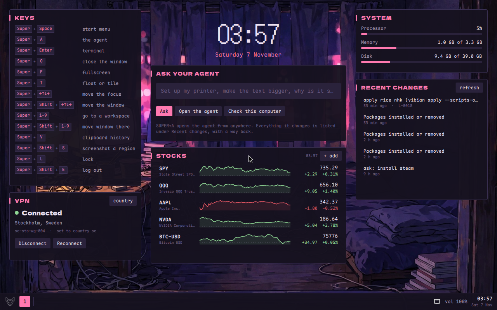
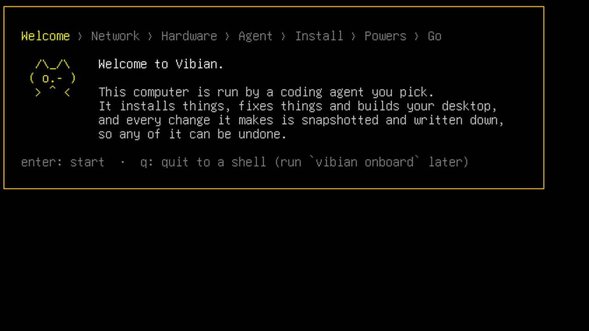
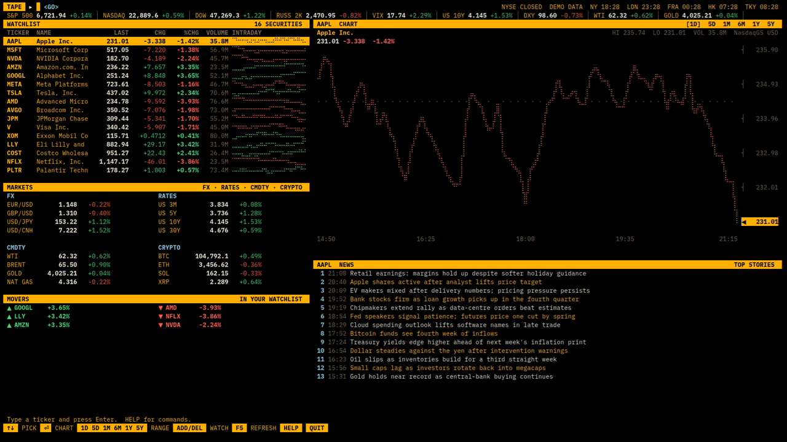
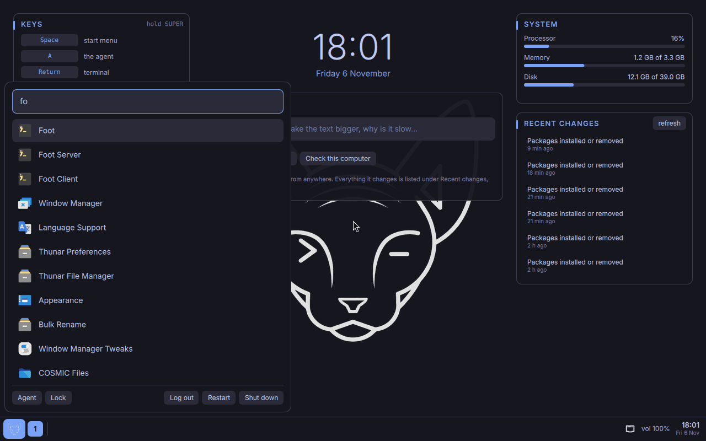
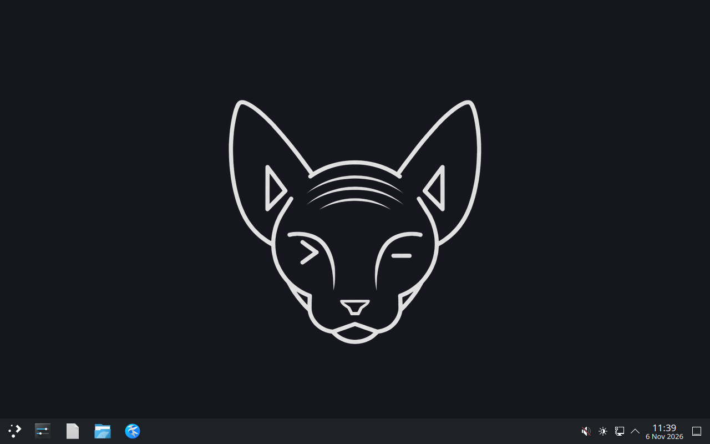
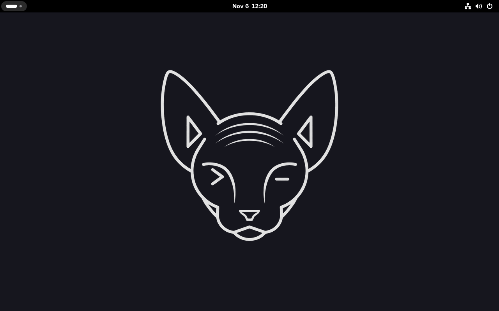
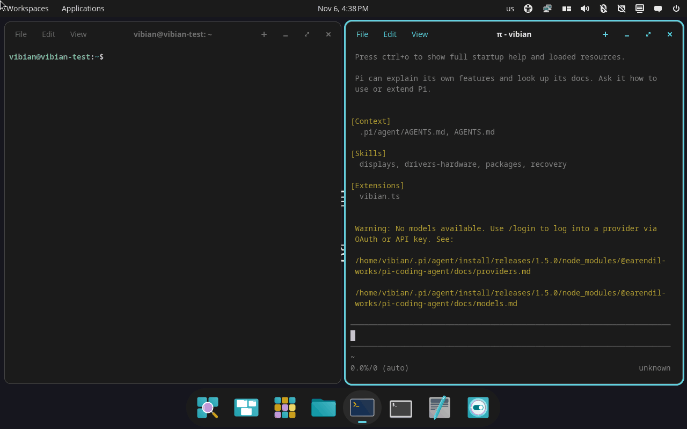
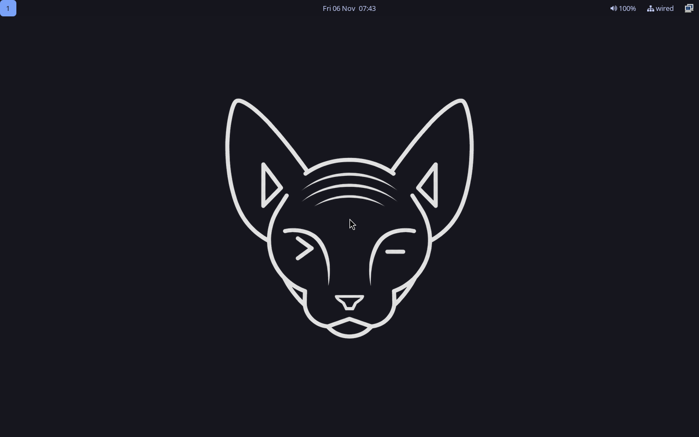
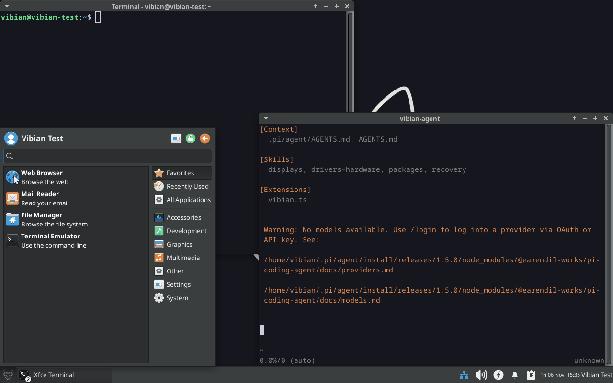

<div align="center">

<picture>
  <source media="(prefers-color-scheme: dark)" srcset="docs/assets/vibian-logo-dark.png">
  
</picture>

# Vibian

### The AI-native Linux distro. It boots to a terminal, and your coding agent builds the rest.

Pick **Claude Code, Codex, Gemini CLI, opencode, OpenClaw, pi or Cursor**. Tell it what you want.<br>
It sets up your drivers, wifi and desktop, and **every change it makes can be undone**.

[](LICENSE)
[](https://ubuntu.com)
[](#works-with-the-agent-you-already-use)
[](https://github.com/jacobzipper/vibian/actions/workflows/harness-install.yml)
[](#status)
[](https://github.com/jacobzipper/vibian/releases)

**[<kbd> <br> Download <br> </kbd>](#download)**
**[<kbd> <br> How it works <br> </kbd>](#how-it-works)**
**[<kbd> <br> Undo everything <br> </kbd>](#undo-everything)**
**[<kbd> <br> Desktops <br> </kbd>](#ten-desktops-to-start-from)**
**[<kbd> <br> Share your rice <br> </kbd>](#share-your-whole-machine)**
**[<kbd> <br> FAQ <br> </kbd>](#faq)**

<br>



<sub>The <a href="rices/nhk/RICE.md">nhk rice</a>, which ships with Vibian: <code>vibian apply nhk</code>. The agent built it from prompts, widgets and all.</sub>

</div>

## What is Vibian?

Vibian is a Linux distribution for people who already live in an AI coding agent. It's Ubuntu 26.04 LTS with no desktop at all. You install it, pick your agent and log in, and from then on the agent runs your computer. It knows the OS: an `AGENTS.md` system brief, 15 skills (drivers, networking, audio, power, recovery, gaming, local AI…) and MCP servers for system state and computer use. It interviews you and builds a desktop to match: Hyprland, KDE Plasma, GNOME, COSMIC, niri, Sway, i3, XFCE, a widget desk, or something nobody has made before.

Giving an LLM root sounds insane. So Vibian is built around **undo**.

## How it works

1. **Install.** Boot the ISO. You get a terminal and an onboarding screen: wifi, then your agent.
2. **Pick your agent.** Vibian installs it from its official source, logs you in, and wires it into the OS (system brief, skills, MCP servers, per-turn snapshot hooks).
3. **Say what you want.** *"Set up my NVIDIA card." "Give me a tiling desktop that feels like macOS." "Make the text bigger."* Talk to the agent in a terminal, or send a quick `vibian ask` and get a notification when it's done.
4. **Undo anything.** Every change is snapshotted and written down. `vibian undo` puts it back.



<sub>One take in a VM, sped up and trimmed: onboarding, then Claude Code installs <a href="rices/tape/RICE.md">tape</a> from one sentence, then undoes it.</sub>

```sh
vibian ask "install steam and quiet the fan"   # runs in the background, between snapshots
vibian history                                 # what changed, when, and which agent did it
vibian undo L-0042                             # put one change back
vibian undo --to 7                             # or roll the whole machine back
```

## "Make me a Bloomberg terminal"



Ask for a trading desk and the agent applies **[tape](rices/tape/RICE.md)**, a rice that ships with Vibian (`vibian apply tape`). It's Hyprland in amber on black with one full-screen, keyboard-driven market terminal: type `NVDA 1Y` and press Enter to chart it, `ADD AMD` to watch it. Quotes, charts and headlines come from Yahoo Finance's free, delayed feeds, so there's no account and no key. It's one Python file, so the agent can add the panel you want next.

## Download

**Vibian 0.7.2 is out**, for **amd64** (Intel and AMD PCs) and **arm64** (ARM machines with UEFI, and ARM VMs like UTM or Parallels on Apple Silicon). Get the ISO from **[Releases](https://github.com/jacobzipper/vibian/releases)**.

GitHub caps release files at 2 GiB, so each ISO comes in two parts:

```sh
cat vibian-0.7.2-amd64.iso.part* > vibian-0.7.2-amd64.iso   # then write it to a USB stick
```

It's pre-alpha: use a spare machine or a VM. **The installer erases the whole disk it installs to**; if there are several, it asks which. The [install guide](docs/INSTALL.md) covers checksums, USB sticks, the installer and first boot.

## Undo everything

- 📸 **Snapshots of `/` and `/home`.** btrfs + snapper, taken before every agent session, after every agent turn that changed something, and around every package change. Your dotfiles are covered too, not just the system.
- 🥾 **Boot into any snapshot from GRUB.** If an agent breaks the boot, pick yesterday in the menu and you're back. `vibian undo --to` makes it stick.
- 📒 **The ledger.** Every change the agent makes goes into plain markdown: the files, the packages, the snapshot pair, how to undo it and what it learned. Any agent can read it, so you can switch from Claude Code to Codex and the new agent already knows your machine.
- 🔐 **Powers you choose.** *Everything* (no prompts, passwordless sudo), *ask first* (the agent asks before each command), or *scoped*: no sudo, every root command logged with a reason, and risky ones (disks, boot, sudoers) wait for `sudo vibian approve`.

## Works with the agent you already use

| Agent | Licence | Snapshot hooks | MCP servers | OS skills |
|---|---|:-:|:-:|:-:|
| [Claude Code](https://claude.com/claude-code) | proprietary | ✅ | ✅ | ✅ |
| [Codex CLI](https://github.com/openai/codex) | Apache-2.0 | ✅ | ✅ | ✅ |
| [Gemini CLI](https://github.com/google-gemini/gemini-cli) | Apache-2.0 | ✅ | ✅ | ✅ |
| [opencode](https://opencode.ai) | MIT | ✅ | ✅ | ✅ |
| [OpenClaw](https://openclaw.ai) | MIT | ✅ | ✅ | ✅ |
| [pi](https://pi.dev) | MIT | ✅ | ✅ | ✅ |
| [Cursor CLI](https://cursor.com/cli) | proprietary | ✅ | ✅ | ✅ |

None are bundled. Vibian installs the one you pick from its official source at onboarding, and you can switch any time with `vibian agent set`. A [weekly check](.github/workflows/harness-install.yml) installs all seven on a fresh Ubuntu 26.04 to catch upstream changes.

## Ten desktops to start from

The agent can build anything, but it doesn't start from nothing. Each **desktop playbook** is a short interview plus tested scripts, and each one passes a VM test on every change. Your agent adapts it to your answers and your hardware.

<table>
  <tr>
    <td align="center"><a href="playbooks/quickshell-desk/PLAYBOOK.md"></a><br><b>Quickshell desk</b><br><sub>Vibian's own desk: taskbar, start menu, widgets</sub></td>
    <td align="center"><a href="playbooks/kde-plasma/PLAYBOOK.md"></a><br><b>KDE Plasma 6.6</b><br><sub>SDDM, Breeze in your accent colour</sub></td>
    <td align="center"><a href="playbooks/gnome/PLAYBOOK.md"></a><br><b>GNOME 50</b><br><sub>upstream-style or Ubuntu-style</sub></td>
  </tr>
  <tr>
    <td align="center"><a href="playbooks/cosmic/PLAYBOOK.md"></a><br><b>COSMIC 1.11</b><br><sub>System76's panel, dock and auto-tiling</sub></td>
    <td align="center"><a href="playbooks/hyprland/PLAYBOOK.md"></a><br><b>Hyprland</b><br><sub>tuigreet, waybar, fuzzel, mako</sub></td>
    <td align="center"><a href="playbooks/xfce/PLAYBOOK.md"></a><br><b>XFCE 4.20</b><br><sub>light and traditional, on X11</sub></td>
  </tr>
</table>

Also: [niri](playbooks/niri/PLAYBOOK.md) (scrolling tiling, built from source with pinned hashes), [Sway](playbooks/sway/PLAYBOOK.md), [i3](playbooks/i3/PLAYBOOK.md) (for old GPUs and anything Wayland struggles with) and [headless](playbooks/headless/PLAYBOOK.md) (a home server or an old laptop with its lid shut: SSH, a firewall, mDNS, tmux). Add the [Ask overlay](playbooks/ask-overlay/PLAYBOOK.md) to any of them for a SUPER+/ box that sends a request to your agent.

## Share your whole machine

Dotfiles share a theme. Vibian shares the **whole setup**: packages, apt sources, services, dotfiles and the ledger of how it was built. The person applying it gets it rebuilt by *their* agent, adapted to *their* hardware.

```sh
vibian export --publish                  # your machine → a git repo, secrets scrubbed
vibian apply github:someone/their-rice   # their machine, rebuilt by your agent
vibian apply nhk                         # or a rice that ships with Vibian
```

Rices are a folder of markdown, scripts and screenshots, so they're easy to read before you run them and easy to send as a pull request.

## Vibian vs Omarchy

Omarchy is great if you want DHH's desktop. Vibian is for people who want *their own*.

| | Omarchy | Vibian |
|---|---|---|
| First boot | DHH's Hyprland desktop | A terminal; your agent interviews you |
| Desktops | One opinionated Hyprland | 10 playbooks, or anything you describe |
| Base | Arch, rolling | Ubuntu 26.04 LTS: `ubuntu-drivers`, NVIDIA, Secure Boot |
| Snapshots | `/` on updates | `/` **and** `/home`, every agent session and turn |
| Agent memory | none | the ledger, readable by any agent |
| Sharing | themes | whole machines, replayed on your hardware |

There's a longer comparison in the [spec](docs/SPEC.md#1-positioning).

## FAQ

<details>
<summary><b>Root for an LLM? Really?</b></summary>

You choose how much power it gets (everything, ask first, or scoped with approvals). Whatever you pick, `/` and `/home` are snapshotted before every session and after every turn that changed something, every change is in the ledger, and any snapshot boots from GRUB. The worst case is a reboot into yesterday.
</details>

<details>
<summary><b>Can I install it today?</b></summary>

Yes, on a spare machine or in a VM. Grab the amd64 or arm64 ISO from [Releases](https://github.com/jacobzipper/vibian/releases) and follow the [install guide](docs/INSTALL.md). It's pre-alpha: the installer erases the whole disk it installs to (it asks which one if there are several). Star or watch the repo to hear about new releases.
</details>

<details>
<summary><b>Proprietary agents in a GPL distro?</b></summary>

No agent is bundled. Vibian installs the one you pick, from its official source, when you pick it. opencode, OpenClaw, pi, Codex and Gemini CLI are open source; the `local-ai` skill sets up Ollama if you want models on your own GPU.
</details>

<details>
<summary><b>Why Ubuntu and not Arch?</b></summary>

LTS means signed NVIDIA drivers, Secure Boot and firmware that just work, and five years of security updates. The agent handles the "but I want the new thing" part: niri and Quickshell, for example, are built from source by their playbooks with pinned hashes.
</details>

<details>
<summary><b>What does the agent actually know about my system?</b></summary>

A system brief (`AGENTS.md`), 15 OS skills (packages, drivers and hardware, displays, networking, audio and bluetooth, power, users and security, services, recovery, computer use, gaming, local AI, dev environments, export and apply, desktop playbooks), the `vibian-system` MCP server (doctor, hardware, ledger, snapshots) and the `vibian-computer` MCP server (screenshots, windows, clicks and keys on Wayland and X11). They live in [`agent-kit/`](agent-kit).
</details>

<details>
<summary><b>"Vibe"… so it's slop?</b></summary>

Playful name, serious engineering: btrfs layout, snapshot boot, an append-only ledger, a VM test for every playbook and a weekly install check for every agent. Read the [spec](docs/SPEC.md).
</details>

## Status

🚧 **Pre-alpha, built in public.** The [first ISOs](https://github.com/jacobzipper/vibian/releases) are out for amd64 and arm64: install them on a spare machine or a VM. The design is in [`docs/SPEC.md`](docs/SPEC.md).

<details>
<summary><b>Everything that works today</b> (each line passes the VM test)</summary>

| | |
|---|---|
| ISO remaster pipeline | ✅ amd64 and arm64 installers, built and published by the [release workflow](.github/workflows/release.yml) on every version tag. Both install and pass the VM test (amd64 under KVM, arm64 emulated); the interactive install and first boot also checked by hand on amd64 |
| Installer disk picker | ✅ with several disks, asks which to erase ([`iso/pick-disk.sh`](iso/pick-disk.sh)); tested in a two-disk VM, both ways round |
| btrfs + snapper autoinstall layout | ✅ boots from `@`, apt snapshots work ([test](tests/vm/headless-install.sh)) |
| grub-btrfs snapshot boot menu | ✅ packaged ([`packages/grub-btrfs`](packages/grub-btrfs)), menu fills in as snapshots are taken. Patched so a crash during a menu rebuild can't lose the menu; sent upstream as [grub-btrfs#446](https://github.com/Antynea/grub-btrfs/pull/446) |
| Booting a snapshot | ✅ pick it in GRUB → the system comes up as it was, in a RAM overlay ([`packages/vibian-base`](packages/vibian-base)) |
| Onboarding TUI, `vibian` CLI, ledger | ✅ first boot lands in onboarding on tty1; `vibian snap/log/undo/doctor` and the git-backed ledger ([`cmd/vibian`](cmd/vibian)) |
| Rollback | ✅ `vibian undo --to <n>`, even from a snapshot boot: the next boot runs the snapshot as `@`, and the old root is kept for 7 days |
| Agent install from onboarding | ✅ all 7 official installers run unattended; pi and opencode are installed and handed over from onboarding in the VM, driven by keyboard ([`tests/vm/drive.sh`](tests/vm/drive.sh)); Claude Code tested with a real login. A [weekly CI check](.github/workflows/harness-install.yml) installs all 7 |
| Agent powers | ✅ *Everything* runs each agent in its no-prompts mode with passwordless sudo. *Ask first* makes every agent ask before commands and edits (opencode through permission rules, OpenClaw through its exec policy; pi has no approval prompts, and onboarding says so). *Scoped* takes sudo away: the agent runs root commands one at a time with `vibian sudo --why … -- cmd`, each is logged, and risky ones wait for `sudo vibian approve <id>` |
| 15 OS skills | ✅ packages, drivers-hardware, displays, networking, audio-bluetooth, power, users-security, services, recovery, computer-use, gaming, local-ai, dev-env, export-apply, desktop-playbooks ([`agent-kit`](agent-kit)) |
| Wifi in onboarding | ✅ NetworkManager; pick a network and type its password on the Network step |
| `vibian-system` MCP server | ✅ `vibian mcp`: doctor, hardware, ledger and snapshot tools, registered in all 7 agents' configs |
| Per-turn snapshots | ✅ `vibian hook` keeps a root+home pair for each agent turn that changed something (at most one per 5 min); hooks or plugins for all 7 agents |
| `vibian history` | ✅ ledger entries and snapshot pairs in one list; `vibian undo --pair <n>` for changes nobody logged |
| Export and apply | ✅ `vibian export` writes the setup as a git repo: packages, dotfiles, apt sources, services, and the ledger. A deny-list, a scrub and gitleaks keep secrets out. `--publish` puts it on GitHub. `vibian apply` hands it to your agent with a plan; `--scripts-only` replays it as-is |
| `vibian-computer` MCP server | ✅ `vibian mcp computer`: screenshot, windows, focus, click/drag/scroll, type, keys on Hyprland, Sway, niri, other wlroots, KDE and X11 (GNOME best effort). VM-tested on Sway (native and uinput input) and X11; Hyprland checked on real hardware; niri and KDE untested |
| Desktop playbooks | ✅ all ten: a short interview, a root script, a user script, and a verify script that must print `VERIFY OK`. Each was also booted to the desktop by hand ([Hyprland](playbooks/hyprland/screenshots/desktop.png), [Sway](playbooks/sway/screenshots/desktop.png), [niri](playbooks/niri/screenshots/desktop.png), [i3](playbooks/i3/screenshots/desktop.png), [XFCE](playbooks/xfce/screenshots/desktop.png), [COSMIC](playbooks/cosmic/screenshots/desktop.png), [KDE](playbooks/kde-plasma/screenshots/desktop.png), [GNOME](playbooks/gnome/screenshots/desktop.png), [Quickshell desk](playbooks/quickshell-desk/screenshots/desktop.png)) |
| Ask overlay | ✅ `vibian ask "make the text bigger"` runs the agent in the background between a snapshot pair and sends a notification when it's done; `vibian asks` lists them. The [Ask overlay](playbooks/ask-overlay/PLAYBOOK.md) puts it on SUPER+/ in any desktop ([screenshot](playbooks/ask-overlay/screenshots/overlay.png)) |
| nhk rice | ✅ `vibian apply nhk`: the [first rice](rices/nhk/RICE.md) ships with Vibian. The Quickshell desk in late-night purple, pink and lamp yellow, with Dela Gothic One, DotGothic16 and Maple Mono, three original wallpapers, and widgets for stocks and Mullvad VPN. Any desk is themed the same way, through `theme.json` |
| tape rice | ✅ `vibian apply tape`: a keyboard-driven market terminal on Hyprland, amber on black: watchlist, charts, news, FX, rates, commodities, crypto. The app is [tested offline](cmd/vibian/rices_test.go). In the VM the rice applies with `VERIFY OK` on Hyprland 0.53.3, tape opens full screen on workspace 1 at login, and SUPER+B reopens it if it was closed or jumps back to it from another workspace |
| More examples (startup mission control, grandma mode) | ⏳ |

</details>

## How Vibian started

Vibian started as one laptop. A stock Ubuntu install became a fully custom anime rice in about a day, entirely by prompting coding agents. It had a Windows-style desk, drag-to-edge tiling, a VPN widget, a local image-generation app and an embedded agent with computer use. Then a second agent picked up where the first left off by reading its change log. Vibian turns that into an OS.

Building it has already turned up an upstream bug. Vibian's snapshot boot menu comes from [grub-btrfs](https://github.com/Antynea/grub-btrfs), around since 2014. Our VM test powers the machine off and boots it into a snapshot, and it caught this: since a January 2023 change, grub-btrfs moved its menu file aside while it scanned the snapshots. A crash or power cut in that window left GRUB with no snapshot menu, at the moment you need one most. Vibian's package carries the fix, and it's sent upstream as [grub-btrfs#446](https://github.com/Antynea/grub-btrfs/pull/446).

## Contributing

Playbooks and rices are markdown plus shell scripts, which makes them good first pull requests. Start from any folder in [`playbooks/`](playbooks) or [`rices/`](rices), and read [`docs/SPEC.md`](docs/SPEC.md) for the design. Issues and ideas are welcome.

## License

[GPL-3.0](LICENSE). Agents are installed from their official sources at onboarding and are never bundled; several are proprietary.
