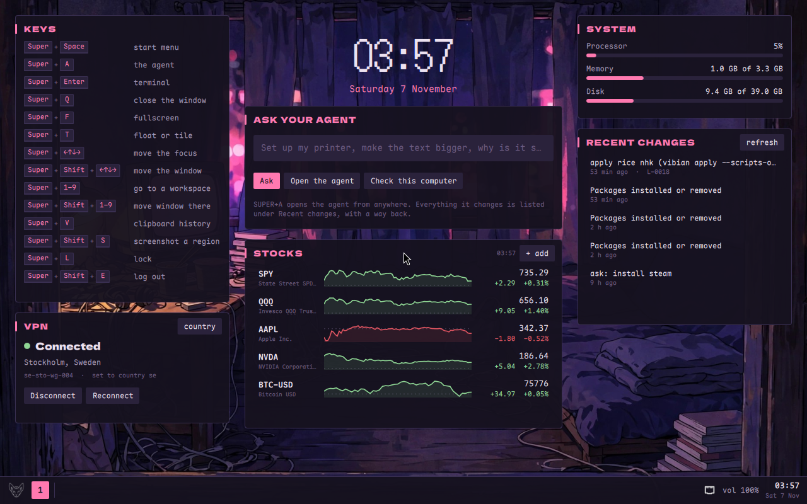

# nhk

A late-night desk: deep purple, hot pink and one warm lamp. It's the
`quickshell-desk` playbook in the colours and type of the desk Vibian
grew up on, with original wallpapers of a small room at 3am, a rooftop and
a rainy street.

- **Colours:** background `#16121f`, cards `#221a30`/`#322645`, text
  `#ece1f0`, pink `#ff79b0` as the accent, violet `#9d7cd8`, lamp yellow
  `#f6d57e`.
- **Type:** Dela Gothic One for titles, DotGothic16 for the big clock,
  Maple Mono NF for everything else and the terminal. All three are under
  the SIL Open Font Licence.
- **Wallpapers:** `~/.local/share/backgrounds/nhk/`: `room.jpg` on the
  desktop, blurred behind the lock screen; `rooftop.jpg` and `street.jpg`
  to swap in. Original art made for Vibian, under the repo's licence.
- **Keys:** the `quickshell-desk` ones. SUPER+Space is the start menu,
  where anything that isn't an app goes to the agent.
- **Widgets:** the `quickshell-desk` set: the clock, the agent, the keys
  as whole combinations, stocks with today's sparklines (`+ add` a
  ticker), the system, recent changes, and Mullvad VPN once the Mullvad
  app is installed.

Apply it with `vibian apply nhk`.

## For the agent applying it
- It builds on `quickshell-desk`. If Quickshell isn't installed yet,
  `scripts/20-desk.sh` builds it with sudo (15 to 30 minutes, once): say
  so before running it. Under `scoped` powers, run the playbook's
  `system.sh` through `vibian sudo` first instead.
- `scripts/10-fonts.sh` downloads the three fonts (pinned, sha256-checked,
  about 25 MB) into `~/.local/share/fonts/nhk`. No sudo.
- `scripts/20-desk.sh` reruns the playbook's user part with
  `VIBIAN_ACCENT=ff79b0 VIBIAN_BG=16121f` and the room wallpaper, so
  Hyprland's borders, mako and the lock screen match. Pass other
  `VIBIAN_…` knobs (keyboard layout, scale, terminal…) through to it if
  the user has them: rerunning the playbook rewrites `hyprland.conf`, but
  `~/.config/hypr/local.conf` is kept.
- The look is all in `~/.config/quickshell/vibian-desk/theme.json`. To
  change a colour or font later, edit that file: the desk reloads at once.
- The terminal colours are in `~/.config/foot/foot.ini`. If the user
  already has one, merge the `[colors]` section and the font line.
- To switch wallpaper: rerun `scripts/20-desk.sh` with
  `VIBIAN_WALLPAPER=~/.local/share/backgrounds/nhk/rooftop.jpg` (an
  absolute path).
