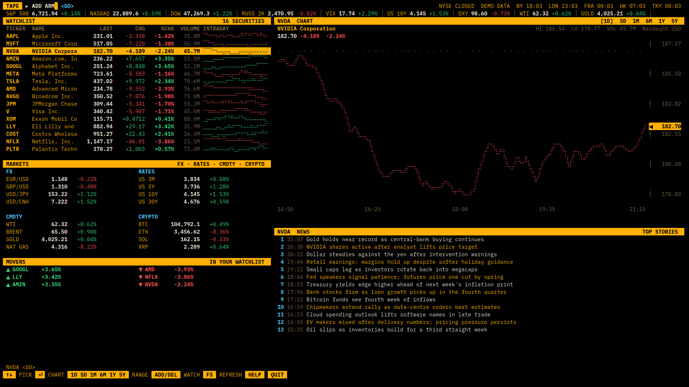
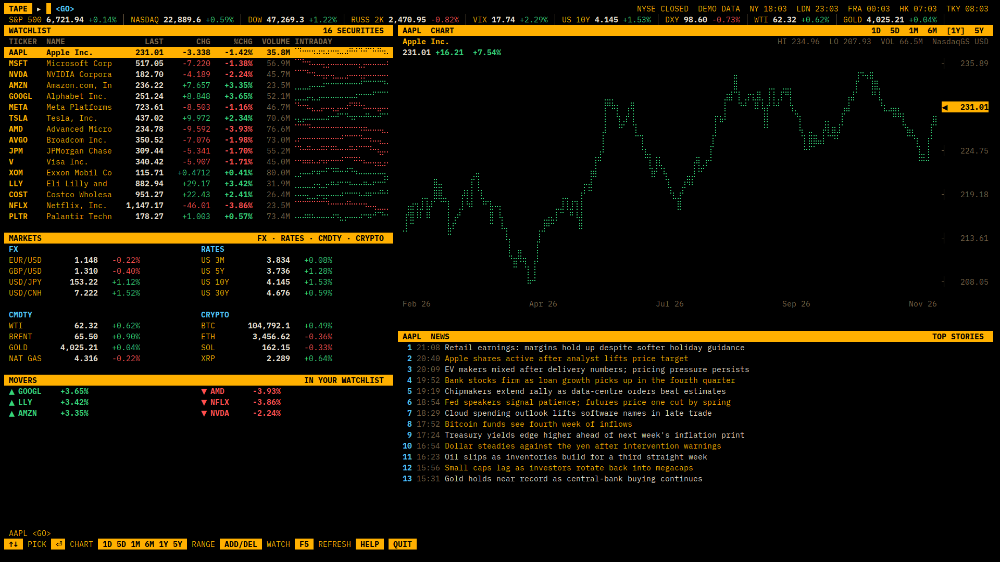
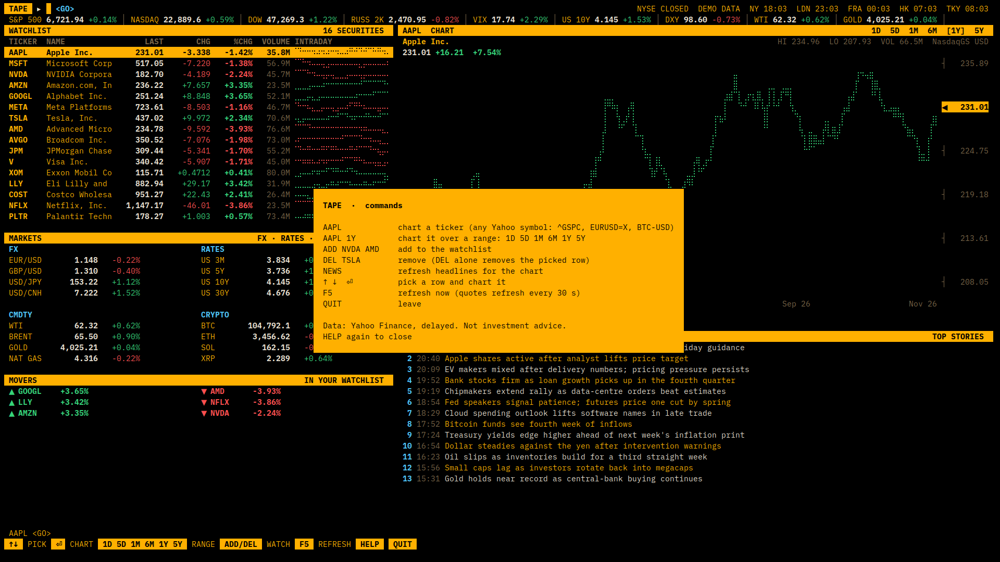

# tape

A market terminal for a desk: amber on black, everything on one screen,
driven from the keyboard. `tape` starts full screen on workspace 1 at
login with a command line at the top, a watchlist with intraday
sparklines, a braille price chart, headlines, FX, rates, commodities,
crypto, the day's movers and the time in five financial centres.

Type a ticker and press Enter to chart it. `AAPL 1Y` charts a year,
`ADD NVDA AMD` and `DEL TSLA` edit the watchlist, ↑ ↓ pick a row, F5
refreshes now, `HELP` lists the rest. Any Yahoo Finance symbol works:
`^GSPC`, `EURUSD=X`, `BTC-USD`, `CL=F`.

- **Data:** Yahoo Finance's public chart API and headline feeds. They're
  free, need no key and run about 15 minutes behind. Quotes refresh
  every 30 seconds. This is not investment advice.
- **Colours:** black `#000000`, amber `#ffb000` for text and headers,
  green `#36d57a` up, red `#ff4f4f` down, a warm grey `#7a6648` for
  labels. The whole terminal (foot) gets the palette, not just tape.
- **Type:** IBM Plex Mono, under the SIL Open Font Licence.
- **Keys:** the `hyprland` playbook ones, plus SUPER+B to bring tape
  back (or start it again).
- **Offline:** `tape --demo` shows made-up prices, which is handy for
  screenshots. `tape --dump 160x45` prints one frame as text.

Apply it with `vibian apply tape`.

## For the agent applying it
- It builds on the `hyprland` playbook. If Hyprland isn't installed,
  run that playbook's `system.sh` with sudo first (under `scoped`
  powers, through `vibian sudo`).
- `~/.local/bin/tape` is the whole app, one Python file with only the
  standard library. Nothing to pip install.
- `scripts/10-fonts.sh` downloads IBM Plex Mono (pinned, sha256-checked,
  about 1 MB) into `~/.local/share/fonts/tape`. No sudo.
- `scripts/20-desk.sh` reruns the playbook's user part with
  `VIBIAN_ACCENT=ffb000 VIBIAN_BG=000000` and keeps the quickshell desk
  if the user has it. It then writes the tape lines (a full-screen window
  rule, the login start and SUPER+B) between `# >>> tape rice` markers in
  `~/.config/hypr/local.conf`. Pass the user's other `VIBIAN_…` knobs
  through to it.
- The watchlist is `~/.config/tape/watchlist.json` (`{"tickers": [...]}`).
  If the user names stocks they follow, write it for them.
- The terminal colours are in `~/.config/foot/foot.ini`. If the user
  already has one, merge the `[colors]` section and the font lines.
  tape uses the terminal's palette (yellow, green, red, cyan, bright
  black), so a different theme recolours it.
- Not wanted at login? Delete the `exec-once` line in the tape block.
